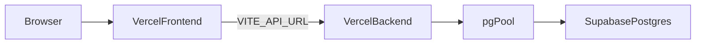

# Production Audit Report

**Date:** 2026-10-14  
**Scope:** Frontend (Vite/React on Vercel) + Backend (Express/`pg` on Vercel) + Supabase Postgres  
**Constraint:** Findings only in Phase 1; fixes tracked in `PLAN.md`.

---

## 1. Architecture summary

| Layer | Technology |
|-------|------------|
| Frontend | Vite 8, React 19, React Router 7 (`BrowserRouter`), Tailwind 4, axios, Highcharts, react-icons |
| Backend | Express 5, `pg` Pool, custom `pgDb` Model API, Zod (partial), JWT Bearer auth |
| Database | PostgreSQL via Supabase (`DATABASE_URL`) |
| Deploy | Separate Vercel projects: static FE `dist`; BE `@vercel/node` → `app.js` |
| Regions | User reports FE/API **bom1**; DB historically **ap-southeast-2** |

### Key entry points

- Frontend: `frontend/src/main.jsx`, `frontend/src/routes/AppRoutes.jsx`
- Backend: `backend/app.js`, `backend/vercel.json`
- DB: `backend/src/config/pool.js`, `backend/src/config/pgDb.js`

---

## 2. Root-cause analysis

### Problem A — 404 `NOT_FOUND` on browser reload

**Root cause (Critical):** The SPA uses history-based routing (`BrowserRouter` in `frontend/src/main.jsx`) with deep paths (`/login`, `/hr`, `/projects/:id`, etc.). There is **no** `frontend/vercel.json` (or equivalent) rewrite of unknown paths to `/index.html`. Hard refresh / direct URL access asks the CDN for a physical file that does not exist → Vercel `404 NOT_FOUND` (e.g. `bom1::xxxxx`).

**Not caused by:** Next.js SSR/SSG, wrong Vite `base` (defaults to `/`), or backend `vercel.json` (API-only).

### Problem B — `EMAXCONNSESSION` (max clients / pool_size 15)

**Compound root cause:**

1. **Serverless × pool size:** `pool.js` creates a module-level `Pool` with `max: 10`, no `globalThis` singleton, no aggressive idle timeouts. Each warm Vercel instance can hold up to 10 sessions; many instances exceed Supabase session-mode limits (~15).
2. **Likely session pooler / port 5432:** Code and `.env.example` favor port 5432; no enforcement of transaction pooler **:6543**. Session-mode + many clients → `EMAXCONNSESSION`.
3. **No `DIRECT_URL`:** Migrations and runtime share one URL.
4. **`fetchAll` architecture:** `pgDb.js` loads entire tables (`SELECT *` + children) then filters in JS for nearly every `find()` / `countDocuments()`.
5. **Amplifiers:** Unauthenticated `/db-status` (dozens of `COUNT(*)`), dashboard analytics `Promise.all` of many full finds, cold-start `seedAccounting()`, FE HR/search fan-outs, 30s notification polling, missing list pagination.

### Problem C — Slow production

| Driver | Evidence |
|--------|----------|
| Large initial JS | No `React.lazy`; ~40 pages statically imported in `AppRoutes.jsx` |
| Highcharts in main graph | Shared `Charts.jsx` imported for charts *and* `formatCurrency` |
| Over-fetch / waterfalls | Full-table lists; HR limit 1000; GlobalSearch 6 APIs |
| Region mismatch | bom1 app vs ap-southeast-2 DB → high TTFB |
| Blocking fonts | Google Fonts stylesheet in `index.html` |

---

## 3. Prioritized findings

| Sev | Area | Location | Impact |
|-----|------|----------|--------|
| Critical | Routing | No `frontend/vercel.json` SPA rewrite | Hard reload 404 |
| Critical | DB | `pool.js` `max:10` × serverless; no `globalThis` | EMAXCONNSESSION |
| Critical | DB | `pgDb.js` `fetchAll` on Model reads | Connection churn + latency |
| Critical | Security | `POST /api/auth/register` + client-chosen `role` incl. admin | Privilege escalation |
| High | DB | Unauthenticated `GET /db-status` | DoS / pool burn |
| High | DB | No :6543 / `DIRECT_URL` / pooler flags | Wrong pooling mode |
| High | Perf | No route code-splitting; Highcharts eager | Slow TTI |
| High | Perf | Most list APIs unpaginated | Slow tables + DB load |
| High | Security | Daily-report download unsanitized `fileName` | Path traversal risk |
| High | Deploy | Vercel region vs Supabase region | Latency |
| Medium | Reliability | No React error boundaries | White-screen on throw |
| Medium | DB | Cold-start `seedAccounting()` in `app.js` | Extra connections |
| Medium | Security | No helmet/CSP/rate-limit; `rejectUnauthorized: false` | Hardening gaps |
| Medium | Perf | 30s notification poll | Background load |
| Medium | Security | `.env` was previously git-tracked | Rotate secrets |
| Low | DX | No TypeScript / CI; unused `useFetch` | Maintainability |
| Low | A11y/SEO | Report only; OG tags present | Polish |

---

## 4. Security notes (detail)

- **Open registration:** `backend/src/routes/auth.routes.js` exposes `/register`; `registerSchema` allows any role including `admin`.
- **`/db-status`:** Public; runs per-collection counts via `pgDb.getCollectionCounts()`.
- **TLS:** `ssl: { rejectUnauthorized: false }` in `pool.js`.
- **Uploads:** Multer allowlists exist; daily-report download joins raw `fileName` into path.
- **CORS:** Allowlist includes production FE + env; requests with no `Origin` allowed (API clients).

---

## 5. Performance notes (detail)

- **Bundle:** Highcharts + all routes in one graph; no `manualChunks`.
- **Tables:** Server pagination only on Users/Employee; most pages fetch full collections.
- **Caching:** No TanStack Query/SWR; axios only; notifications poll every 30s.
- **Observability:** No Sentry / Vercel Analytics in repo.

---

## 6. Out of scope / deferred risks

- Full rewrite of `pgDb` away from `fetchAll` (large behavioral risk) — plan incremental SQL filters/limits.
- Destructive schema changes / RLS enablement — require explicit approval.
- Moving Supabase project region — manual infra action.
